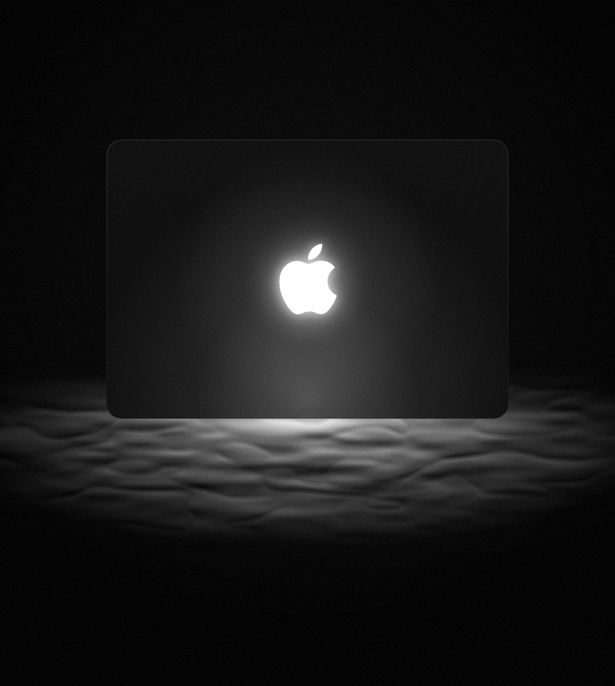

# I got a new light!



Turning off the glowing logo on a MacBook Pro with PROLED XDR display takes a `sudo` command in Terminal, and [turning it back on takes another](https://support.apple.com/en-us/149248). Those commands work, but they never show whether the light is on, and you have to look them up each time. I got a new light! is a small native Mac app that replaces both commands with one click on a logo.

## Build and run

The app builds from source with one script, on an Apple silicon Mac running macOS 14 or later with Xcode installed.

```bash
git clone https://github.com/pujunru/I-got-a-new-light.git
cd I-got-a-new-light
./build.sh
open "build/Logo Light.app"
```

Click the logo to toggle the light. The first click only checks the current state, because the app starts out not knowing it.

| Action | Shortcut |
| :--- | :--- |
| Toggle the light | Click the logo, Space, or ⌘L |
| Check the status | ⌘R |

To try the interface without a password, run `./build.sh --preview` and open `build/Logo Light Preview.app`. The preview uses a fake backend and never touches the real setting.

## How it works

The app runs Apple's two commands and nothing else. It asks for your password through the standard macOS admin prompt, because the setting lives in the root user's preferences. Each change ends by reading the value back, so the window shows what macOS stored, not what the app requested.

Reading that value also needs root, so the app remembers the last state it confirmed. That is why opening the app never asks for a password, and why a change made in Terminal stays invisible until you press ⌘R.

## Limits

- **Hardware:** Apple documents the setting only for the MacBook Pro with PROLED XDR display.
- **Scope:** Apple says the setting applies to every user account and to macOS Recovery, and that it migrates to a new Mac.
- **Testing:** the command logic and interface are tested, but the real admin prompt and the physical light are not confirmed yet.
- **Trademark:** this project is not affiliated with Apple, which owns the Apple logo.
